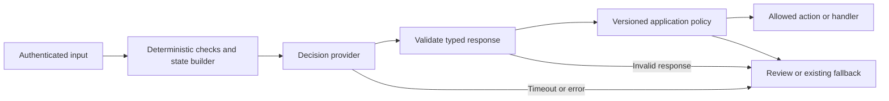

# Integrate decision models into an application

Add a decision model to your application's backend using a hosted API or a released local model. This guide covers provider contracts, Python and TypeScript calls, response validation and fallback handling. Start with labeled, non-sensitive examples before connecting a model to business actions. For an end-to-end rollout, see [application blueprints](application-blueprints.md) and the [API and model comparison dated 12 October](../research/decision-model-refresh-2026-10-12.md).

## Choose the contract before the model

Follow the [support-routing example](domain-adoption-guide.md) to connect hosted evaluation, reviewed domain data, local or cloud training and application rollout.

| Route | Actual interface | Authentication / model selector | Important distinction |
|---|---|---|---|
| TypeSafe Jev, direct | `POST https://api.typesafe.ai/v1/systemone` | Bearer TypeSafe key; `jev-1.13.0` | Text/JSON state; `choice`, `noul`, `score` |
| OpenRouter decision models | `POST https://openrouter.ai/api/alpha/decisions` | Bearer OpenRouter key; e.g. `typesafe/jev-1.13` | Alpha Decisions endpoint; provider routing and response model/provider identity matter |
| Perplexity Decider, direct | `POST https://api.perplexity.ai/v1/decisions` | Bearer Perplexity key; `pplx-decider-v1.1-27b` | Its own limits and modality contract; preserve the exact path without a trailing slash |
| Cloudflare Clef Flash, direct | Workers AI binding `env.AI.run("@cf/cloudflare/clef-flash", payload)` or account-scoped REST | Scoped Cloudflare token; payload model `clef-flash` | HTTP envelope differs from the Workers binding; text-state truncation needs explicit qualification |
| TypeLLM | Python `TypeLLMClient.generate(context=..., questions=...)` | TypeLLM key | Typed **generation**, conditional fields and open-ended strings; distinct from a closed-answer decision head |
| Vega, self-hosted | Python `vegaml.load(...).decide(state, questions)` | Pinned local/Hub weights; no hosted API established by these sources | Uses `boolean`, not Jev's `noul`; returns `probs`, conformal information and `abstain` |
| This platform, released domain model | `POST /v1/projects/{project_id}/decisions` | Local scoped key or configured enterprise access token | Schema comes from the active release; callers send `state` and `threshold`, not arbitrary questions |

Sources: [TypeSafe HTTP contract](https://docs.typesafe.ai/api), [OpenRouter Decisions reference](https://openrouter.ai/docs/api/api-reference/alphadecisions/submit-a-decisions-request), [Perplexity quickstart](https://docs.perplexity.ai/docs/decisions/quickstart), [Workers AI Clef Flash](https://developers.cloudflare.com/workers-ai/models/clef-flash/), [TypeLLM workflows](https://typellm.ai/docs/workflows), [pinned Vega API](https://github.com/NandhaKishorM/vegaml/blob/01d2850408084034e27174621c19e01f0f0b9e92/vegaml/__init__.py).

OpenRouter's reviewed ranking links identify `cloudflare/clef-flash`, `cloudflare/clef`, `perplexity/pplx-decider-v1.1-27b`, `liquid/d1` and `jaredpalmer/kev-4b` as additional decision-model routes. Confirm account availability, input handling and response schema per route. Equal request syntax does not make probabilities or calibrated thresholds interchangeable. [Model directory and usage ranking](https://openrouter.ai/rankings/decisions)

## Add a bounded decision to an existing project

Choose one existing boundary with a measurable failure cost: a support ticket's destination, a passage's relevance, an invoice's review queue, or an agent tool call's risk. Keep the current handler as the fallback. Record its accuracy, review rate, response time and cost before inserting the model.



The backend owns question definitions and trusted policy. User text is evidence, not permission to alter the schema or execute a tool. Perform arithmetic, authorization, inventory lookups and date comparisons in code. Send only evidence available at decision time; omit outcome labels and unnecessary customer identifiers. Attach a schema/policy version to the decision record. These are project design recommendations, grounded in the [TypeSafe building pattern](https://docs.typesafe.ai/concepts/how-to-build-with-system-one) and [LangChain harness](https://www.langchain.com/blog/building-a-harness-with-jev).

A **choice** selects a named option and returns `probabilities`. A **noul** returns `noul`, the probability of yes. A **score** uses an ordered rubric; its `score` is an expected level, which may be fractional. Jev's `confidence` summarizes concentration of a distribution; it is not the winner's probability. Threshold the quantity you evaluated on your domain. [Primitive semantics](https://docs.typesafe.ai/primitives), [confidence semantics](https://docs.typesafe.ai/confidence)

### Python HTTP integration

Install `httpx` in your application's environment and provide `OPENROUTER_API_KEY` through its secret manager. This example proposes a ticket destination and never performs the routing side effect. The caller supplies `min_probability`, `expected_model` and `expected_provider` from a previously evaluated policy. Those identity values come from the response observed during qualification, not by assuming the request alias is also the returned revision. Save this function in the application's backend service, and reuse the client across requests.

```python
import math
import os
import httpx

QUESTIONS = {
    "team": {
        "type": "choice",
        "instructions": "Which queue should review the ticket? Use other if evidence is insufficient.",
        "criteria": {
            "billing": "Invoices, charges or refund questions",
            "technical": "Product failures or configuration problems",
            "other": "Any other topic or insufficient evidence",
        },
    }
}

def propose_queue(
    client: httpx.Client,
    ticket: str,
    min_probability: float,
    *,
    expected_model: str,
    expected_provider: str,
) -> dict:
    if type(min_probability) not in (int, float) or not math.isfinite(min_probability) \
            or not 0 <= min_probability <= 1:
        raise ValueError("Invalid evaluated threshold")
    if not isinstance(ticket, str) or not ticket.strip() or len(ticket.encode("utf-8")) > 32768:
        raise ValueError("Invalid ticket evidence")
    if not all(isinstance(v, str) and v.strip() for v in (expected_model, expected_provider)):
        raise ValueError("Missing qualified model/provider identity")
    response = client.post(
        "https://openrouter.ai/api/alpha/decisions",
        headers={"Authorization": "Bearer " + os.environ["OPENROUTER_API_KEY"]},
        json={
            "model": "typesafe/jev-1.13",
            "state": {"ticket": ticket},
            "questions": QUESTIONS,
            "provider": {"allow_fallbacks": False, "only": ["typesafe"]},
        },
        timeout=httpx.Timeout(15.0, connect=3.0),
        follow_redirects=False,
    )
    response.raise_for_status()
    body = response.json()
    if not isinstance(body, dict) or body.get("model") != expected_model \
            or body.get("provider") != expected_provider:
        raise ValueError("Decision response changed qualified model/provider identity")
    answers = body.get("answers")
    if not isinstance(answers, dict) or set(answers) != set(QUESTIONS):
        raise ValueError("Decision response changed question IDs")
    answer = answers["team"]
    expected = set(QUESTIONS["team"]["criteria"])
    if not isinstance(answer, dict):
        raise ValueError("Invalid answer object")
    probs = answer.get("probabilities")
    if answer.get("type") != "choice" or not isinstance(probs, dict) or set(probs) != expected:
        raise ValueError("Decision response does not match schema")
    if any(type(p) not in (int, float) or not math.isfinite(p) or not 0 <= p <= 1
           for p in probs.values()):
        raise ValueError("Invalid probability")
    if abs(sum(probs.values()) - 1.0) > 0.002:
        raise ValueError("Unnormalized decision response")
    raw_probs = probs
    total = sum(raw_probs.values())
    probs = {key: value / total for key, value in raw_probs.items()}
    label = answer.get("choice")
    if not isinstance(label, str) or label not in expected or probs[label] != max(probs.values()):
        raise ValueError("Invalid winning option")
    accepted = label != "other" and probs[label] >= min_probability
    return {
        "proposed_queue": label if accepted else "manual_review",
        "probabilities": probs,
        "raw_probabilities": raw_probs,
        "model": body["model"],
        "provider": body.get("provider"),
        "request_id": body.get("id"),
        "usage": body.get("usage"),
    }
```

Handle `httpx.HTTPError`, JSON errors and response validation errors at the application boundary by returning the existing fallback or review state. Do not default a missing `noul` to zero or a missing choice to an apparently valid label. A short timeout is an application budget here, not a provider latency claim. The normalization tolerance is an explicit example policy; qualify it against the selected provider's precision and schema size. Accepted rounding error is renormalized before the threshold is applied, and the raw values are retained.

OpenRouter's official example requests `typesafe/jev-1.13` and returns a dated model identity, `typesafe/jev-1.13-20260917`, with provider `TypeSafe`. Record that resolved identity in the evaluated policy. The example restricts routing to the `typesafe` provider slug. Disabling fallback alone does not pin the model revision or the initial provider; qualify the applicable routing options and still validate the response. A changed identity requires a new study rather than silently reusing a threshold. [Decisions request/response example](https://openrouter.ai/docs/api/api-reference/alphadecisions/submit-a-decisions-request), [provider routing](https://openrouter.ai/docs/guides/routing/provider-selection)

For a direct Jev adapter, use `https://api.typesafe.ai/v1/systemone`, the key to `TYPESAFE_API_KEY`, and model to `jev-1.13.0`; omit OpenRouter's request `provider` field. For a direct Perplexity adapter, use its endpoint, key and model from the table and omit that field. These are separate adapters: confirm each provider's answer and identity envelope before adapting the validator above. A direct provider may omit OpenRouter's response `provider` field; establish its identity through the fixed trusted endpoint and its documented response metadata rather than inventing a field or silently disabling checks. Preserve the raw provider response separately from your application policy result.

### TypeScript SDK and Cloudflare binding

OpenRouter's reviewed tutorial pins SDK `1.3.17`. Its method is `alpha.decisions.create`, rather than chat completions. Install a pinned version in your project lockfile and test upgrades. [Official SDK example](https://openrouter.ai/blog/tutorials/how-to-use-jev/)

```typescript
import { OpenRouter } from "@openrouter/sdk";

const router = new OpenRouter({ apiKey: process.env.OPENROUTER_API_KEY! });
const result = await router.alpha.decisions.create({
  model: "typesafe/jev-1.13",
  state: { ticket: "Please send a copy of the invoice." },
  questions: {
    team: {
      type: "choice",
      instructions: "Which queue should review this ticket?",
      criteria: { billing: "Invoices and payments", other: "Everything else" },
    },
  },
});
// Validate result.answers.team before applying your evaluated routing policy.
```

Inside an existing Cloudflare Worker with an AI binding, the corresponding call is:

```typescript
const result = await env.AI.run("@cf/cloudflare/clef-flash", {
  model: "clef-flash",
  state: { ticket: "Please send a copy of the invoice." },
  questions: {
    team: {
      type: "choice",
      instructions: "Which queue should review this ticket?",
      criteria: { billing: "Invoices and payments", other: "Everything else" },
    },
  },
});
```

Cloudflare documents a **24,576-token context window** for Clef Flash in the reference dated **12 October 2026**. Questions and media share the window, and text state can be truncated to fit. Check complete-input token counts or route long documents elsewhere. Validate the response format for the REST or Workers binding you use before adapting the parser. [Model limits and examples](https://developers.cloudflare.com/workers-ai/models/clef-flash/)

### Call your released local domain model

After training and owner activation, an existing application can call the scoped platform route:

```python
import os
import httpx

with httpx.Client(base_url=os.environ["DMT_API_URL"], timeout=30.0) as client:
    response = client.post(
        f"/v1/projects/{os.environ['DMT_PROJECT_ID']}/decisions",
        headers={"Authorization": "Bearer " + os.environ["DMT_INFERENCE_KEY"]},
        json={"state": "Please send a copy of the invoice.", "threshold": 0.9},
    )
    response.raise_for_status()
    result = response.json()
    print(result["release_revision"], result["answers"], result["abstained"])
```

Replace the example threshold `0.9` with one measured on your domain. The active release fixes the schema and model. Fetch expected release information through an authorized administrative workflow, then check `model_id`, `release_revision`, `schema_sha256` and abstention before acting. The API cannot atomically pin a caller-selected release for each request; reject unexpected identities at the application boundary. See [deployment](deployment-guide.md), [authentication](authentication-guide.md) and [evaluation](evaluation-guide.md).

Vega uses a different local library boundary. The following is the **historical 10 October profile**, retained for its source pin. The selected 0.8.0 mode and complete engine/backbone pins are in the [Vega guide](vega-guide.md); use that guide for new work and consult [runtime compatibility](compatibility-and-upgrades.md) before upgrading. Its reviewed loader accepts a Hub revision:

```python
import vegaml

model = vegaml.load(
    "nandakishorm/vega-08b-public-intents",
    revision="c85f2338fcc965f5ab0050a5752200e86fa8f63b",
    mode="engine",
)
result = model.decide(
    {"ticket": "Please send a copy of the invoice."},
    {"billing": {
        "type": "boolean",
        "instructions": "Is this about an invoice or payment?",
        "criteria": {"true": "Invoice or payment", "false": "Other topic"},
    }},
)
```

Pin the Vega package, checkpoint and backbone separately. This historical example uses a different library contract from the platform adapter; use the [Vega guide](vega-guide.md) for the application's current profile. Map `boolean`, `probs` and `abstain` explicitly if your application expects Jev-style fields. Test long inputs against the exact version: source revisions differ in whether they reject or shorten inner prompt spans. [Pinned loader](https://github.com/NandhaKishorM/vegaml/blob/01d2850408084034e27174621c19e01f0f0b9e92/vegaml/__init__.py), [version comparison](../research/decision-model-expansion-2026-10-10.md)

### Identity assurance depends on the route

| Evidence | What it establishes | Remaining limit |
|---|---|---|
| Fixed trusted endpoint + authenticated response | Selected transport | Does not identify immutable weights |
| Returned model/provider strings | Detects documented name changes | Names can be aliases or echoes |
| Pinned local manifest + verified files | Exact assets loaded by the qualified loader | Still requires held-out/deployment acceptance |

Perplexity documents that `model` echoes the request. Validate that name and the fixed endpoint while recording that they cannot attest immutable weights. Gateway identity checks also do not turn mutable names into artifact hashes. Preserve route-specific assurance and requalify changed behavior/revisions. [Perplexity identity semantics](https://docs.perplexity.ai/docs/decisions/quickstart)

## Build new applications around decisions

| Application | State and judgments | What application code owns | Acceptance measure |
|---|---|---|---|
| Support intake | Ticket plus available product facts; queue and evidence sufficiency | Permissions, queue assignment, SLA arithmetic and review | Critical misrouting, coverage, p95 end-to-end latency |
| Invoice categorization | Extracted invoice description; known category or `new` | Approved taxonomy, accounting rules, duplicate detection and payment authorization | Owner agreement, unknown-category detection, review cost |
| RAG evidence filter | Query and retrieved passage; supports-answer probability | Retrieval, source access, citation identity and answer generation | Answer correctness and unsupported-answer rate |
| Agent tool gate | Proposed action plus trusted target/permission facts; risk class | Independent authorization, command validation, execution and approvals | False-safe rate; episode success, not only single-call accuracy |
| Model cascade | Request characteristics; suitable handler | Budget, timeouts, fallback and actual answer production | Whole-task quality and total cost including escalations |

These are proposed project recipes, not measured improvements. Build a small replayable study before adding automation. The [X article](https://x.com/akshay_pachaar/status/2101037514945597645) provides conceptual examples; its launch-era availability and performance numbers need current primary-source verification.

### Invoice discovery before fixed-schema training

The [TypeLLM cookbook](https://typellm.ai/cookbook/discover-invoice-categories?v=2) and [pinned notebook](https://github.com/TypeLLM/TypeLLM/blob/7c5b2805c9390377621b4c513bdaab39ff8b5413/examples/notebooks/discover_invoice_categories.ipynb) start with `travel` and `legal`. A string enum includes `new`; a conditional string field names a new category only when needed. The notebook automatically appends names. For an enterprise training workflow, make the name a **proposal** until an owner reviews it:

```python
import os
from typellm import TypeLLMClient

client = TypeLLMClient(api_key=os.environ["TYPELLM_API_KEY"])
approved_categories = ["travel", "legal"]
result = client.generate(
    context="Invoice: Train fare for a customer visit",
    questions={
        "category": {
            "type": "string", "enum": approved_categories + ["new"],
            "instructions": "Select a fitting approved category; otherwise select new.",
        },
        "new_category": {
            "type": "string", "when": {"category": "new"},
            "instructions": "Propose a broad snake_case category name.",
        },
    },
).result
```

The notebook requests `typellm>=0.6.7`; choose and lock a tested version rather than treating that lower bound as a reproducible environment. This call generates candidate labels/names, not calibrated decision-head training targets. Validate returned names and enums, deduplicate aliases and prohibit reserved names. Batch proposals against a versioned taxonomy; concurrent workers must not append categories independently. Review examples, freeze the approved schema, convert accepted rows into `state/questions/gold`, and reserve real holdouts before generating synthetic training data. A subsequent taxonomy change creates a successor schema/model study. This extends the source example with this project's governance protocol; the [reviewed taxonomy workflow](taxonomy-guide.md) wires optional TypeLLM discovery into proposals and owner-confirmed successor schemas. It remains separate from synthetic training-data generation and calibrated decision-head inference.

## Qualify reliability and economics

Start in shadow mode with no side effects, then allow only evaluated low-risk branches. Keep owner-approved real calibration and test records, including absent evidence, out-of-domain cases and hostile instructions embedded in state. Model probabilities alone are not an authorization boundary.

Bound concurrency, request size and total request time. Retry only documented transient errors with jitter and `Retry-After`, under a fixed total deadline/attempt budget; a timed-out request may still incur provider billing. Never automatically retry a downstream payment or write because an inference retry succeeded. Use an application idempotency key/outbox for actual business actions. Record model/provider/request identity, schema/policy hashes, probability distributions, latency, billed usage, fallback and final human outcome without dumping sensitive input into general logs.

Compare `provider charges + fallback charges + review time + errors + operations` per completed task at matched quality. For local models, include idle GPU capacity and operational cost. An apparent zero per-call tariff does not make a self-hosted system free. Provider fallback, model migration, quantization and threshold changes require replay qualification. Track drift and outcome availability, and retain rollback to the previous application policy/model release.

## Platform provider integration

Use the [hosted decision workflow](hosted-decisions-guide.md) to evaluate a provider against reserved project data, fit local calibration, register a policy and release it through authenticated inference. Check access, response identity, costs and domain quality with your selected account before release. See [provider compatibility checks](verification.md#provider-compatibility-checks).
