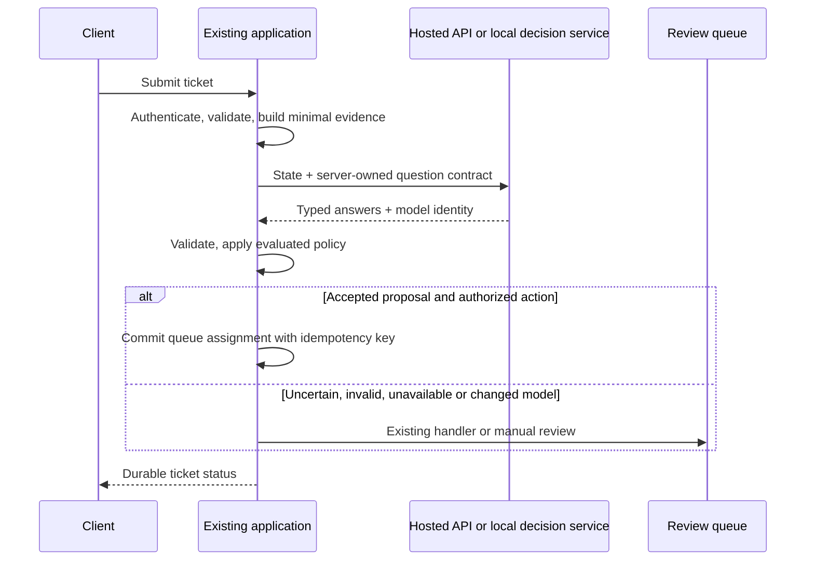

# Build applications that use decision models

[All guides](README.md) · [Project overview](../README.md)

Use decision models for support routing, invoice categorization, retrieval filtering, agent action review or model cascades. The designs below explain where to insert a model, what evidence to collect and how to measure the result. Connect them using the [API examples](api-integration-guide.md), then follow the [evaluation guide](evaluation-guide.md#evaluation) before automating a branch.

## Extend an existing application

Start with a handler that already works and one judgment that is expensive or brittle. For example, a support service may already authenticate users, store tickets and assign queues. Add a decision proposal between ticket creation and assignment. Keep permissions, the assignment transaction and SLA calculations in that service.

Keep a domain adapter behind an interface such as `propose_queue(evidence, policy_version)`. Return the proposal, complete distribution, abstention, provider/model identity and study version. Keep the action handler responsible for transactions and permissions. [LangChain's Jev harness](https://www.langchain.com/blog/building-a-harness-with-jev) illustrates separating model decisions from application actions.

Before enabling writes, replay the same historical decision-time evidence through the existing handler and candidate adapter. Freeze the question/rubric, model route, calibration procedure and acceptance criteria. Run shadow traffic, then a bounded canary for an approved branch. Roll back the application policy and model together if coverage, critical errors or end-to-end latency violate the frozen limits. A timeout is a failed proposal, not proof that the remote request was never billed.

Store a decision record alongside the business entity: tenant/project, input reference or permitted content hash, schema/policy hashes, returned identities, probabilities, applied threshold, proposal, final action, fallback reason, elapsed time and available human outcome. Keep sensitive evidence in its authorized record store. A hash is not anonymization, and later outcomes must not leak into earlier replay inputs.

## Five projects to build

### 1. Support routing and escalation

Use ticket text, available product facts and trusted customer-service metadata as `state`. Define a queue choice with an `other` outcome, an evidence-sufficiency question and an ordinal urgency rubric. Keep customer authorization and actual queue assignment deterministic. A high urgency score should propose escalation; application code checks the SLA and the user's permissions.

Collect examples by ticket family and time, including unresolved, ambiguous and multilingual tickets. Measure critical misrouting, review rate, coverage, delay and total handling cost. Start with hosted shadow inference; adapt a local Laya model when a stable domain and reviewed examples justify training. A cheaper model is useful only if the completed workflow meets the same acceptance criteria.

### 2. Invoice category assistant

Extract descriptions and verified business context before classification. Keep tax calculations, duplicate checks, approval limits and payment execution in code. Define canonical category IDs with owner-approved descriptions. Missing context and unfamiliar vendors should reach review rather than force a familiar category.

Use TypeLLM's [invoice discovery notebook](https://github.com/TypeLLM/TypeLLM/blob/fd9b97a06386d1898d2c241796c3c81bd10db9c0/examples/notebooks/discover_invoice_categories.ipynb) to understand enum-plus-conditional-name generation. In this project, proposed names go through [taxonomy review](domain-schema-guide.md#category-discovery). An owner confirms a successor schema; categories do not grow inside concurrent inference requests. Keep discovery examples and known relatives out of independent holdouts. Train the fixed-schema specialist only after category review. Evaluate category agreement, unseen-category recall, review effort and duplicate/alias behavior.

### 3. Retrieval evidence filter

The retrieval system first enforces document access. Submit the query and one authorized passage, or a bounded explicitly identified passage set, to a support/relevance rubric. Preserve passage IDs in application records; choice IDs cannot confer access to a hidden source. The answer generator sees selected evidence and still needs an answer-level correctness check.

Create positives, distractors, near duplicates, contradictory passages and questions with no supporting document. Split by source document/entity and time. Evaluate completed answers and citation support as well as passage classification. Compare the whole retrieval-plus-generation pipeline: removing passages may reduce token cost while also removing necessary evidence.

### 4. Agent action review

Represent a proposed action using a server-validated tool ID, authorized target and bounded arguments. Let the decision model judge semantic risk or evidence sufficiency. Independent authorization, sandbox limits and deterministic argument checks run regardless of the judgment. An uncertain or unavailable model returns the configured review/denial path.

Reserve complete agent episodes, including attempted prompt injection, ambiguous targets and tool failures. Measure unauthorized-action escape rate, valid-task completion and compounded error across the episode. A safe label on one call does not prove an entire agent workflow is safe. The [Jev launch article](https://typesafe.ai/blog/introducing-system-one-models-and-jev) motivates typed branching; it is not independent security acceptance for this design.

### 5. Model cascade and workload triage

A decision model selects among approved handlers: deterministic code, a specialist, a generative model or a human queue. It does not generate the final answer. The application owns deadlines, total budget and allowed fallbacks. Track the selected route and the final outcome, including requests that escalated or failed.

Optimize against total cost per successfully completed task at a frozen quality target. Include classifier calls, final-model calls, retries, review, errors and idle infrastructure. Prevent self-reinforcing labels by sampling human review from accepted as well as escalated traffic. Hold out complete original requests; repeated attempts from the same request stay together.

## A new domain-model project from intake to release

1. Ask the owner to describe the decision, available evidence, outcomes, exclusions and error costs in natural language. Show the proposed question contract and request explicit confirmation.
2. Offer the exact [data format](data-guide.md#data-contract), a few editable examples and CSV/XLSX/TSV/JSON/JSONL intake. Preview worksheets and map columns before saving. Preserve missing-label drafts rather than silently inventing gold.
3. Review real examples and reserve independent validation, calibration and locked test roles before synthesis. Group entities, duplicates, known relationships and seed descendants. Record decision/evidence/label times when available.
4. Ask what additional training coverage is needed. Generate candidates from approved training seeds, record teacher/prompt/source lineage and require review. Generated candidates remain training-only; a large synthetic corpus does not replace real gold.
5. Train a CPU comparison and a chosen decision backend locally or using one of the [five cloud workflows](remote-training-guide.md#study-protocol). Keep identical study inputs and acceptance policy across compute locations.
6. Fit calibration on its reserved role, evaluate the final exported runtime and inspect abstention, subgroup and business-cost behavior. Select model settings using validation rather than repeated test inspection.
7. Admit the full export, obtain owner release approval and expose the scoped inference endpoint. Application-side policy validates release identity before acting; monitoring and rollback retain the previous accepted version.

These are application designs to implement in your own product. The repository provides data, training and decision-service components; each product still needs its business handlers, evaluation and deployment checks.
