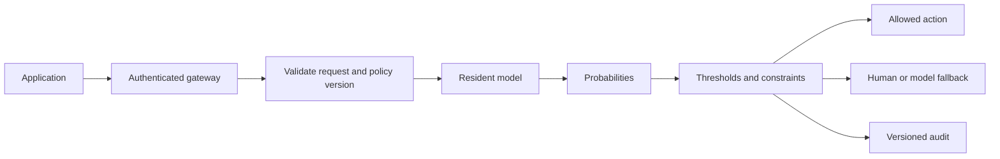

# Host the application or a model service

[Documentation](../README.md) · [Project overview](../../README.md)

Application hosting runs the browser, API, workers and durable stores. A separately hosted native-model endpoint has its own runtime and serving contract. Renting a GPU for training is a third, separate operation.

## Choose a section

- [Deploy the workbench on AWS, Azure or GCP](#application-hosting)

- [Local and managed model-serving contracts](#native-model-serving)

## Deploy the workbench on AWS, Azure or GCP

Application hosting runs the browser, API and durable workers for your users. It is separate from renting a GPU for an individual training run.

| Target | Application deployment | Training jobs |
|---|---|---|
| AWS | [ECS Fargate, RDS and S3](aws.md) | [SageMaker training](../remote-training/aws.md#direct-submission) |
| Azure | [Container Apps, PostgreSQL, Blob and Key Vault](azure.md) | [Machine Learning jobs](../remote-training/azure.md#direct-submission) |
| Google Cloud | [Cloud Run, Cloud SQL, GCS and Secret Manager](gcp.md) | [Custom GPU training](../remote-training/gcp.md#direct-submission) |

These recipes use pinned CPU control-plane images. They support CPU baseline training, hosted decision policies, data/review workflows and the existing remote-training controllers when their profiles and permissions are configured. Native model execution needs matching runtimes and resources; the supplied hosting profiles do not add a GPU. See [model environments](../setup.md#configuration--configure-model-training-and-serving).

Configure [shared-workspace operations](../shared-workspace-operations-guide.md), [organization sign-in](../authentication-guide.md#organization-sign-in) and [coordinated recovery](../recovery-guide.md#shared-workspace-recovery) before production adoption. Validate networking, identity, quotas, storage and model quality in your own deployment.

## Local and managed model-serving contracts

Run the complete workbench locally or host it for your team. Use the [AWS, Azure and GCP application-hosting recipes](README.md#application-hosting) for the browser, API, workers, PostgreSQL, shared artifacts and service identities. These CPU application profiles are separate from native-model serving and GPU training. The managed inference options below describe custom-container contracts for a model service; they require a runtime-specific wrapper.

### Preserve the complete contract

Bundle backbone, decision head, tokenizer/processor, adapters or merged weights, temperatures, schema and policy versions. A normal generation endpoint does not automatically execute a decision head.

First reload an Unsloth export with [predict_unsloth.py](../../scripts/predict_unsloth.py) and compare predictions. Unsloth documents merged-checkpoint registration through `UNSLOTH_SYSTEMONE_MODEL` and its Decision API. A local `jev-latest` alias does not imply TypeSafe weights. [Serving guide](https://unsloth.ai/docs/models/decision-laya), [export recipe](https://unsloth.ai/docs/basics/train-your-own-decision-model-with-unsloth)

### Local usage

Use the [local container guide](../container-guide.md) to run the three CPU services with named-volume persistence. Run its lifecycle verifier after building your image to check training, inference, service replacement and cold recovery.

For Vega and semantic encoders, use the [Linux model image guide](../model-container-guide.md#linux-model-image). It provides a CUDA dependency lock, standalone eight-file training command, authenticated lifecycle verifier and optional Compose override. Check your GPU, mounted assets and authentication configuration before using it with domain data.

Bind the intake app to loopback. Keep records and artifacts private. A local generative teacher can synthesize data without a remote service after its weights are downloaded.

Native Laya can register named checkpoints with `LAYA_EXTRA_MODELS`; check the installed release's map format. [Laya release notes](https://github.com/NandhaKishorM/laya)

Separate training and serving if memory is constrained. Measure cold load, resident memory and warmed latency. Offline operation requires cached weights and dependencies; a local app configured with a hosted teacher still sends that teacher data.

### Enterprise design

Return model/policy version, outcome, probabilities and request identifier. Enforce input, question and option limits. Learned scores do not replace authorization or payment arithmetic.

Partition tenant data, caches, artifacts and training jobs. Derive tenant identity from authenticated service context.

### Host the workbench

| Target | Application stack | Walkthrough |
|---|---|---|
| AWS | ECS Fargate, RDS PostgreSQL, S3, ALB and Secrets Manager | [AWS application hosting](aws.md) |
| Azure | Container Apps, PostgreSQL, Blob Storage and Key Vault | [Azure application hosting](azure.md) |
| Google Cloud | Cloud Run services and worker pool, Cloud SQL, GCS and Secret Manager | [GCP application hosting](gcp.md) |

Follow the selected guide's prerequisites, bootstrap and authentication steps before exposing services. Configure organization sign-in, monitoring and recovery for your deployment. A CPU hosting image does not supply native model weights or a GPU runtime.

### Separate managed model-serving options

| Target | Integration | Official contract |
|---|---|---|
| AWS SageMaker AI | Custom inference container wrapping the runtime | [Hosting contract](https://docs.aws.amazon.com/sagemaker/latest/dg/your-algorithms-inference-code.html) |
| Google Cloud managed ML | Custom prediction container and health/prediction routes | [Container contract](https://cloud.google.com/vertex-ai/docs/predictions/use-custom-container) |
| Azure Machine Learning | Custom container behind managed online endpoint | [Deployment guide](https://learn.microsoft.com/en-us/azure/machine-learning/how-to-deploy-custom-container?view=azureml-api-2) |
| Existing Kubernetes / VM | Model service behind established ingress/identity | Follow the enterprise platform's conventions |

Match the runtime to each provider's serving contract. SageMaker requires its invocation and health routes; Google Cloud requires the custom prediction-container contract; Azure requires an environment and route configuration. Use the linked official specifications when building the wrapper.

A custom container must execute the selected decision head and return its typed probabilities. Confirm this explicitly when using a managed model catalog or a generic text-generation serving stack.

### Economics and operating acceptance

Measure monthly service cost divided by successful completed cases. Include uptime, utilization, minimum replicas, training, synthesis, storage, egress, retries, fallback and operations. Token tariff alone is an inadequate self-hosting comparison.

Verify readiness, authentication, tenant separation, bounded queues, deadlines, memory recovery, metrics, drift, canary and rollback. Use enterprise policy for raw-state logging.

The default local platform provides an authenticated API, SQLite persistence, independent jobs and release/inference routes for compatible exports. Experimental [PostgreSQL metadata](../shared-artifacts-guide.md#postgresql-metadata) can be paired with shared artifacts in [S3](../shared-artifacts-guide.md#s3-artifacts), [Azure Blob Storage](../shared-artifacts-guide.md#azure-blob) or [GCS](../shared-artifacts-guide.md#google-cloud-storage). Follow [local backup and recovery](../recovery-guide.md#local-backups) for SQLite, [coordinated recovery](../recovery-guide.md#shared-workspace-recovery) for PostgreSQL/object storage and [authentication](../authentication-guide.md#workspace-credentials) for credentials and trusted JWT mappings. Metadata-only PostgreSQL deployments need database backups with the corresponding local artifacts.

### Training and application integration

Use [remote training](../remote-training-guide.md#study-protocol) when local VRAM is insufficient, then [admit the export](../remote-training-guide.md#returned-model-admission) and release it. Training alone does not create a prediction endpoint. To call provider-hosted models from an existing backend, follow [API integration](../api-integration-guide.md). Validate the selected provider account and image using [provider compatibility checks](../verification.md#provider-compatibility-checks), and follow [Windows process ownership](../model-container-guide.md#windows-process-ownership) when running local model processes on Windows.
