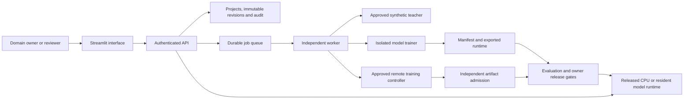

# Application architecture

[All guides](README.md) · [Project overview](../README.md)

The platform combines a browser interface, authenticated HTTP API, durable workspace and independent worker. SQLite is the personal default; experimental [PostgreSQL metadata](postgresql-guide.md) can use shared model artifacts in [S3](shared-artifacts-guide.md), [Azure Blob Storage](azure-artifacts-guide.md) or [Google Cloud Storage](gcs-artifacts-guide.md). Training runs outside web requests. Multi-host operation still requires compatible node environments, staging access, identity and operational configuration; shared model files alone do not supply those controls.

## State and identity

Personal local startup creates a temporary hashed API credential and connects the loopback-bound Streamlit server automatically. The direct Streamlit entry can start one owned API/worker pair; the CLI supervises the same services alongside the browser server. Projects persist in a separate personal directory, while credentials are renewed on restart. Personal mode shares one owner identity among browsers reaching that local server; shared deployments retain explicit workspace authentication. See [workspace modes](setup.md#personal-and-shared-workspaces).

Projects pin policy and questions. Reviews append immutable dataset revisions; jobs pin the revision and prepared role hashes they consume. Worker ownership tokens prevent a stale process from committing another worker's result. Authentication derives tenant and role from operator credentials or trusted JWT mappings rather than client-supplied tenant claims. [Data](data-guide.md), [authentication](authentication-guide.md)

## Training and serving

The [model directory](models/README.md) lists CPU, Laya, Unsloth, Vega, Liquid, D3 and native Perplexity adapters, each with distinct dependency, data and hardware contracts. Training separates selection, calibration and locked evaluation. Native exports include the required weights, configuration, tokenizer or processor, calibration, reports and a file manifest; the CPU baseline uses its own JSON contract. Release checks the model contract and frozen owner criteria; a failed run does not replace the active release. Resident native model processes, native training and model admission share a host capacity lease while retaining workspace ownership locks. Participating services must use the same lock file and filesystem; CPU baseline jobs remain independent. [Capacity configuration](setup.md#shared-model-capacity-on-one-host), [training](training-guide.md), [Vega](vega-guide.md)

## External operations

Hosted studies retain route identity, a local calibration policy and call accounting; provider weights remain hosted. Remote training uses an approved frozen study and provider profile, records uncertain submissions without replay, and validates retrieved artifacts before registration. Check upstream resource state after an uncertain local outcome. [Hosted studies](hosted-decisions-guide.md), [remote admission](remote-admission-guide.md)

## Enterprise extension

The [application-hosting recipes](application-hosting/README.md) configure the browser, API, durable workers, PostgreSQL, shared artifacts and service identities on AWS, Azure and GCP. The [deployment guide](deployment-guide.md) also covers separate native-model serving contracts. Supplied hosting images run the CPU control plane; native model execution needs matching runtimes and resources. Validate identity, networking, recovery and model quality in the target deployment.
