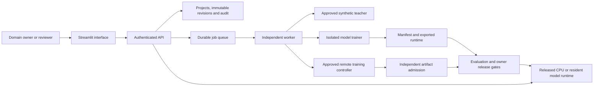

# Architecture and supported capabilities

[Documentation](README.md) · [Project overview](../README.md)

The browser, authenticated API, durable worker and model runtimes have distinct responsibilities. The sections below explain their boundaries and the supported workflows.

## Choose a section

- [Application architecture](#architecture)

- [Capabilities and operating limits](#supported-capabilities)

## Application architecture

The platform combines a browser interface, authenticated HTTP API, durable workspace and independent worker. SQLite is the personal default; experimental [PostgreSQL metadata](shared-artifacts-guide.md#postgresql-metadata) can use shared model artifacts in [S3](shared-artifacts-guide.md#s3-artifacts), [Azure Blob Storage](shared-artifacts-guide.md#azure-blob) or [Google Cloud Storage](shared-artifacts-guide.md#google-cloud-storage). Training runs outside web requests. Multi-host operation still requires compatible node environments, staging access, identity and operational configuration; shared model files alone do not supply those controls.

### State and identity

Personal local startup creates a temporary hashed API credential and connects the loopback-bound Streamlit server automatically. The direct Streamlit entry can start one owned API/worker pair; the CLI supervises the same services alongside the browser server. Projects persist in a separate personal directory, while credentials are renewed on restart. Personal mode shares one owner identity among browsers reaching that local server; shared deployments retain explicit workspace authentication. See [workspace modes](setup.md#configuration--personal-and-shared-workspaces).

Projects pin policy and questions. Reviews append immutable dataset revisions; jobs pin the revision and prepared role hashes they consume. Worker ownership tokens prevent a stale process from committing another worker's result. Authentication derives tenant and role from operator credentials or trusted JWT mappings rather than client-supplied tenant claims. [Data](data-guide.md#data-contract), [authentication](authentication-guide.md#workspace-credentials)

### Training and serving

The [model directory](models/README.md) lists CPU, Laya, Unsloth, Vega, Liquid, D3 and native Perplexity adapters, each with distinct dependency, data and hardware contracts. Training separates selection, calibration and locked evaluation. Native exports include the required weights, configuration, tokenizer or processor, calibration, reports and a file manifest; the CPU baseline uses its own JSON contract. Release checks the model contract and frozen owner criteria; a failed run does not replace the active release. Resident native model processes, native training and model admission share a host capacity lease while retaining workspace ownership locks. Participating services must use the same lock file and filesystem; CPU baseline jobs remain independent. [Capacity configuration](setup.md#configuration--shared-model-capacity-on-one-host), [training](training-guide.md), [Vega](vega-guide.md#vega-model)

### External operations

Hosted studies retain route identity, a local calibration policy and call accounting; provider weights remain hosted. Remote training uses an approved frozen study and provider profile, records uncertain submissions without replay, and validates retrieved artifacts before registration. Check upstream resource state after an uncertain local outcome. [Hosted studies](hosted-decisions-guide.md), [remote admission](remote-training-guide.md#returned-model-admission)

### Enterprise extension

The [application-hosting recipes](application-hosting/README.md#application-hosting) configure the browser, API, durable workers, PostgreSQL, shared artifacts and service identities on AWS, Azure and GCP. The [deployment guide](application-hosting/README.md#native-model-serving) also covers separate native-model serving contracts. Supplied hosting images run the CPU control plane; native model execution needs matching runtimes and resources. Validate identity, networking, recovery and model quality in the target deployment.

## Capabilities and operating limits

Use the workflows below to create a domain project, review examples, train a model and release an authenticated decision endpoint. Each guide explains the required inputs, configuration, outputs and operating limits.

| Capability | How to use it | What you receive | Boundary |
|---|---|---|---|
| Persistent domain projects | [Create a project](setup.md#configuration--use-the-application), describe its policy and confirm its questions | A project you can reopen after browser or service restarts | Personal SQLite by default; [shared PostgreSQL and cloud storage](application-hosting/README.md#application-hosting) require explicit deployment configuration |
| Guided domain intake | Describe available evidence, policy exceptions and data needs; build category, yes/no or rating questions; [enter examples](data-guide.md#data-contract) and optionally set [domain error criteria](evaluation-guide.md#error-cost-policy) | An owner-confirmed schema, saved requirements and reviewed examples | The owner defines the policy; natural-language text does not automatically become model labels or acceptance thresholds |
| Operator encrypted recovery | [Generate a key, capture, verify and restore](recovery-guide.md#encrypted-backups) using a separately retained checksum; [schedule captures and verified retention](recovery-guide.md#scheduled-backups) | Authenticated encrypted all-tenant bundles, durable receipts and a fresh recovered workspace | Approved private storage and key custody required; single-host scheduling, offsite operation and enterprise supervision need qualification |
| Shared workspace recovery | [Capture, verify and restore PostgreSQL with S3, Azure Blob or GCS](recovery-guide.md#shared-workspace-recovery) | Consistent logical metadata, independent versioned artifacts and a fresh restored workspace | Private plaintext metadata, versioned recovery storage and compatible schema required; cloud-account and deployment restore drills remain separate |
| Shared workspace operations | [Use queue limits, readiness and scoped failure monitoring](shared-workspace-operations-guide.md) | Four pending jobs per tenant, durable worker ownership and cached storage connectivity | One bounded two-API/two-worker functional workload; no universal capacity, model integrity or deployed-cloud claim |
| Backup freshness and failure monitoring | [Publish signed health and configure its API trust profile](recovery-guide.md#backup-monitoring) | Scoped incidents and safe backup summaries; optional required-readiness behavior | Public-key verification; basic availability/freshness indicators, with complete verification/restore drills and external alert integration separately required |
| Immutable dataset revisions | [Import, append and review examples](data-guide.md#data-contract) | Versioned rows, hashes and reviewer history; stale edits return a conflict | Imported approval flags are not trusted |
| Assigned annotation work | [Assign examples and complete reviews](data-guide.md#assigned-review) | Persistent reviewer queues and immutable assignment/draft/completion history | Positive example collections; assignments do not grant access or establish label correctness |
| Synthetic coverage from training seeds | [Configure a teacher](setup.md#configuration--configure-a-teacher), reserve real holdouts and [request coverage](data-guide.md#data-contract--generate-and-review-synthetic-candidates) | Queued, unapproved candidates with seed lineage | Review generated labels and measure the selected teacher's domain quality |
| Durable job submission and status | [Submit preparation or training](product-workflow.md) and inspect the job status | Persistent status and idempotent submission | An interrupted job is not permission to replay an uncertain external operation |
| Concurrent worker ownership | [Run API and worker separately](setup.md#configuration--run-services-individually) | Transactional job claims, heartbeats and stale-worker completion fencing | SQLite by default; experimental [PostgreSQL metadata](shared-artifacts-guide.md#postgresql-metadata) and optional [shared model artifacts](shared-artifacts-guide.md#s3-artifacts) with separate staging/operational limits |
| Native Laya training | [Use the native adapter](training-guide.md#native-laya-adapter) with four reviewed splits | A trained decision head, independent calibration, FP32 export and reload report | The default freezes the encoder; validate memory and quality before changing hardware or training mode |
| CPU comparison baseline | [Select the CPU backend](setup.md#configuration--use-the-application) | Trained TF-IDF/logistic classifier, calibrated JSON export and reload checks | Fixed-schema comparison model; it does not train a foundation decision head |
| Tenant-scoped access | [Provision credentials](authentication-guide.md#workspace-credentials--workspace-key-lifecycle), configure trusted identities or enable [organization sign-in](authentication-guide.md#organization-sign-in) | Server-derived tenant/role checks, optional OIDC browser login and token revocation | Real enterprise issuer configuration, claims and account permissions need deployment-specific validation |
| Domain error costs and critical labels | [Configure a frozen error policy](evaluation-guide.md#error-cost-policy) | Per-question policy-cost estimates, class-specific error rates and release refusal for failed limits | Forced-classification evaluation; independent operational gold and deployed-action costs need separate qualification |
| Frozen acceptance criteria | [Set quality and class-count gates](data-guide.md#data-contract--inspect-readiness-before-training) before the first training submission | Immutable criteria bound to a model study and its release decision | Domain owners must select meaningful limits and independent gold |

### Other documented paths

Use the [model directory](models/README.md) for the complete backend list, including [Liquid](models/liquid.md), [D3 family](models/d3-family.md), [hosted decision studies](hosted-decisions-guide.md) and [remote training](remote-training-guide.md#study-protocol). Match the selected backend's dependency, data, provider and approval requirements.

Use [testing and compatibility](verification.md) for installation checks, provider checks and domain evaluation before deployment.
